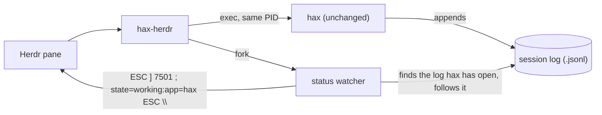

# hax-herdr

Shows [hax](https://github.com/OleksandrChekhovskyi/hax)'s status in [Herdr](https://herdr.dev) —
**working**, **done**, or idle — on its tab and in the agents list, without changing hax.

Herdr learns what an agent is doing from [OSC 7501](https://github.com/herdrdev/herdr-core#status-comes-from-the-program),
the Program Status Protocol. hax doesn't speak it, and by design has no hooks or plugins.
`hax-herdr` is a small launcher that runs the real hax and reports its status for it, reading
the session log hax already writes. Your hax install stays exactly as it is, so `brew upgrade hax`
keeps working and there is no fork or patch to rebase.

## Install

You need macOS on Apple silicon, [hax](https://usehax.dev) 0.6 or later,
[Herdr](https://herdr.dev), a Rust toolchain (1.88+) and `jq`. Linux is supported too (CI builds
and unit-tests it), but has seen less real use than macOS.

```bash
git clone https://github.com/aravindhsampath/hax-herdr
cd hax-herdr
make install
```

`make install` does two things:

| What | Where |
| --- | --- |
| The `hax-herdr` binary | `~/.local/bin/hax-herdr` (set `PREFIX` to change `~/.local`) |
| A `hax` entry for Herdr: its name, and how to start it from the **+** menu | `programs` in `~/.config/herdr-app/programs.json`, merged with what's there |

Make sure `~/.local/bin` is on your `PATH`.

## Use

- **From Herdr:** click **+** in the tab bar and pick **hax**.
- **From a shell in a Herdr pane:** run `hax-herdr` instead of `hax`. It takes the same arguments.

To keep typing `hax`, add a shell function to `~/.zshrc` or `~/.bashrc`:

```bash
hax() { hax-herdr "$@"; }
```

That's safe everywhere. Outside Herdr, or when hax's output isn't going to a terminal
(`hax -p ... | jq`, scripts, subagents), `hax-herdr` just runs hax and does nothing else.

## What Herdr shows

| In hax | Herdr status |
| --- | --- |
| Started, waiting at the prompt | `idle` |
| A turn is running: you sent a prompt, continued a paused one, or pressed Enter after an interrupt | `working` |
| The turn finished, or Esc paused it after the current step | `done` |
| Esc Esc interrupted the turn (you're already there) | `idle` |
| hax exited | cleared by Herdr |

There's no `blocked` status: hax never stops to ask permission or questions mid-turn.

## How it works



1. `hax-herdr` reports `idle` before hax draws anything, forks a watcher, then **execs hax**. hax
   keeps the PID Herdr started, so Herdr sees `hax` running, and hax's exit code is the pane's.
2. The watcher asks the OS which session log hax has open (`proc_pidfdinfo` on macOS,
   `/proc/<pid>/fd` on Linux). That's exact, even with several hax sessions in the same folder,
   and it follows `/new`, `/fork` and `/resume`.
3. It reads new lines as they're appended. hax writes a turn's `turn_boundary` (and the prompt)
   *before* calling the model, and a `user_turn` record when the turn ends. The format is
   documented in hax's [`docs/sessions.md`](https://github.com/OleksandrChekhovskyi/hax/blob/master/docs/sessions.md),
   and this tool relies on nothing else. Records copied by `/fork` (`inherited`) and compactions
   (`compact_seed`) don't count as turns.
4. Each change is written to the terminal as one OSC 7501 report, in a single `write`, so it
   can't land inside another report. The watcher ignores Ctrl-C and Ctrl-\ (they're for hax),
   and exits as soon as hax does.

**Cost:** a 460 KB binary. The watcher wakes four times a second for a few syscalls: about
1.5 MB resident and roughly 0.05% of one core while idle. Dependencies are `libc`, `serde` and
`serde_json`.

## Limitations

- **Single Esc reads as `done`.** One Esc asks hax to pause after the current step. The log
  records that like a finished turn, so Herdr shows `done` rather than `idle`.
- **Failed turns read as `done`.** The session log doesn't mark a turn that ended in a provider
  error, so there's no `error` status.
- **`--no-session` means no log.** hax writes no session log, so the pane only shows `idle`.
- **Small timing window.** The watcher writes to the same terminal hax draws on. Reports are
  tiny, single writes made when a turn starts or ends. In theory one could land between two
  writes hax makes for a single escape sequence, leaving a few stray characters until hax
  repaints. It hasn't shown up in testing.

Native OSC 7501 support in hax would remove these limitations, and make this tool unnecessary.
It could sit next to hax's existing `notify` (`src/terminal/notify.c`).

## Develop

```bash
make check   # rustfmt, clippy, tests (cargo-nextest), shellcheck
make e2e     # runs hax-herdr in a real herdr-core terminal
```

`make e2e` uses hax's built-in mock provider and a throwaway state folder, so it touches no
real sessions and makes no network calls. It sends prompts, Esc Esc and Enter through `hc`,
and checks that Herdr recorded `idle working done working idle working done`. It needs `hc`
(installed with Herdr), `hax` and `jq`.

## Uninstall

```bash
make uninstall
```

This removes the binary and the `hax` entry from Herdr's `programs.json`. If you added the
shell function, remove it from your shell config.

## License

[MIT](LICENSE)
